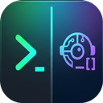
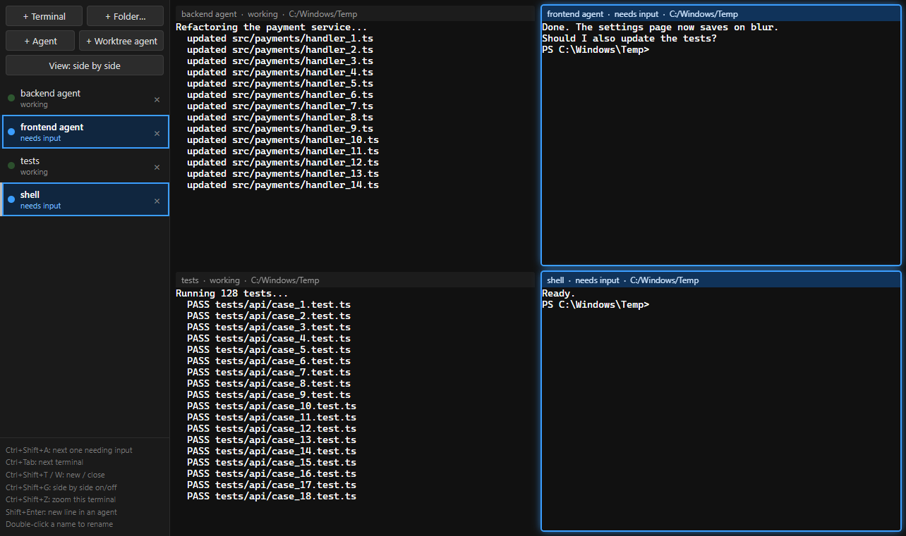

<p align="center"></p>

# Klyngex

Parallel terminal workspace for coding agents.

Run several terminals side by side in one window. When an agent finishes or asks a question, its terminal gets a blue ring, the taskbar flashes and a notification tells you which one it was.



## Features

- **Side by side or one at a time.** A grid of every terminal, or a single one. Zoom any pane to full size and back.
- **See who needs you.** Each terminal is marked working, idle, needs input or exited. The ring stays until something is running in that terminal again.
- **Exact status for Claude Code.** Agents started with `+ Agent` report through Claude Code hooks, so the ring appears the moment Claude stops or asks for permission.
- **Worktree agents.** `+ Worktree agent` starts Claude Code in a new git worktree, so parallel agents do not overwrite each other.
- **Works with anything else too.** Other programs are tracked by their output: a terminal that printed while you were away and then went quiet is flagged.
- **Remembers your layout.** Terminal names and folders come back after a restart.

## Status

Early. Built and tested on Windows 11 only. macOS and Linux are untested. There is no installer yet; run it from source.

## Run from source

Requires [Node.js](https://nodejs.org) 20 or newer. The agent buttons also need [Claude Code](https://claude.com/claude-code) on your PATH.

```
git clone https://github.com/SondreGarnes/klyngex.git
cd klyngex
npm install
npm start
```

## Shortcuts

| Keys | Action |
|---|---|
| Ctrl+Shift+A | Jump to the next terminal that needs input |
| Ctrl+Tab / Ctrl+Shift+Tab | Next / previous terminal |
| Ctrl+Shift+T / Ctrl+Shift+W | New terminal / close terminal |
| Ctrl+Shift+G | Side by side on or off |
| Ctrl+Shift+Z | Zoom the current terminal |
| Shift+Enter | New line (in Claude Code and PowerShell) |
| Ctrl+C / Ctrl+V | Copy the selection / paste |

Double-click a name in the sidebar to rename a terminal. Double-click a pane header to zoom it.

## How "needs input" works

- **Claude Code agents started from the app** are launched with `--settings claude-hooks.json`. Its hooks call a small server that Klyngex runs on `127.0.0.1`, using a per-terminal address in the `KLYNGEX_HOOK` environment variable. Nothing is added to your own Claude Code settings.
- **Everything else** uses a rule of thumb: output that arrived while you were not looking, followed by 2.5 seconds of silence, or a terminal bell. A long silent command can trip it.

## Development

```
npm test
```

Plain Electron with [xterm.js](https://xtermjs.org) and [node-pty](https://github.com/lydell/node-pty). No bundler and no framework. `CLAUDE.md` describes where things are.

## License

[MIT](LICENSE)
